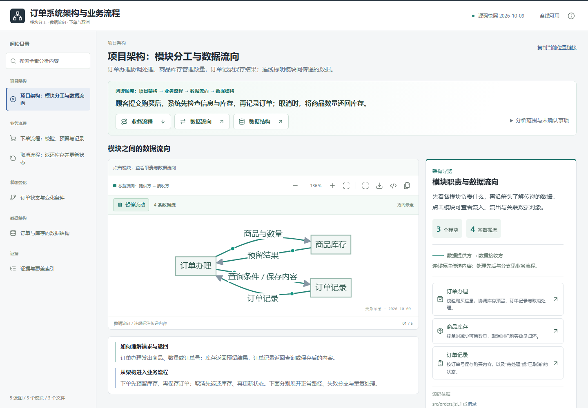

# repo-atlas

**用项目架构、业务流程、数据流向与数据结构理解一个项目。**

[](https://github.com/Lxiny-zy/repo-atlas/actions/workflows/ci.yml)
[](LICENSE)

[English](docs/README.en.md) · [命令参考](docs/cli.md) · [清单格式](docs/manifest-format.md) · [参与贡献](.github/CONTRIBUTING.md)



repo-atlas 把人工或 AI 辅助编写的 `atlas.json` 转换成可离线探索的单文件 HTML。人通过架构图、数据流图、流程图和 ER 图理解项目，点击模块或数据对象继续探索关系。源码以辅助链接和结构化依据保留，供 AI 核对及增量维护。

适合接手陌生代码库、追踪一个功能的完整链路、交付可持续更新的架构说明。**它不会自动理解业务，也不把静态关系当成运行时调用证明。**

## 五分钟体验

需要 Node.js 18+；建议使用仍受官方维护的 Node.js LTS。构建没有 npm 运行时依赖，无需先执行 `npm install`。

```sh
git clone https://github.com/Lxiny-zy/repo-atlas.git
cd repo-atlas
node scripts/validate.mjs examples/order-journey/atlas.json
node scripts/build.mjs examples/order-journey/atlas.json
```

直接打开 `examples/order-journey/report.html`：先看模块职责与数据流向，再按下单、取消两个场景理解处理顺序和分支，最后查看状态与数据结构。模块之间只展示数据流向，点击模块可查看流入、流出及传递内容。正文默认不展示代码块，源码通过链接追溯。示例使用合成源码，数据结构明确标注为内存对象。再次构建同一输出需追加 `--replace`。

数据流图上的标记沿箭头移动，可播放或暂停；点击模块只保留关联的数据流动画。动画演示清单中声明的方向，不表示实时运行、传输速度或执行先后。系统开启“减少动态效果”时默认静止，SVG 导出与打印保留静态箭头。

编写自己的报告前，可参考[读者体验与表达约束](docs/analysis-guide.md#面向读者的表达)：用业务名称组织标题与阶段，函数、路径和字段保留在定位细节中。

想体验完整的多链路报告：

```sh
node scripts/build.mjs tests/fixtures/multi-chain/atlas.json
```

打开 `tests/fixtures/multi-chain/report.html`。报告内嵌 Mermaid、图标、样式和交互脚本，不依赖 CDN 或本地服务器。

## 能做什么

| 需求 | 实现 |
|---|---|
| 理解项目架构 | 查看模块分工与边界，点击模块突出关联的数据流 |
| 追踪数据流 | 动态标记展示提供方 → 接收方，支持暂停、模块聚焦与载荷说明 |
| 看清业务流程 | 分支流程图、时序图、状态图与业务阶段联动 |
| 理解数据结构 | 点击 ER 对象查看字段、键、逻辑关联或数据库外键 |
| 追溯与 AI 维护 | 源文件超链接、按需摘录、结构化关系与证据索引 |
| 暴露知识缺口 | confirmed / inferred / unverified，以及独立的覆盖和复核状态 |
| 维护旧报告 | 文件哈希、Git 基线、受影响实体、未归属变化和增量上下文 |
| 交付审核版本 | 显式复核单、新版本目录、报告完整性回执与语义版本比较 |

链路覆盖率只计算适用阶段，不把未确认阶段当成已覆盖。关系导航反映清单中的知识，不据此判断变更影响半径或合并安全性。

## 用于自己的项目

1. 阅读[清单格式](docs/manifest-format.md)，参考 [atlas.example.json](schemas/atlas.example.json) 创建项目文档目录下的 `atlas.json`。
2. 设置 `workspace`，它**相对清单所在目录**解析；证据路径、文件分组和 `output` 均相对 workspace。
3. 为模块、链路与结论选择少量真实源码证据，写明分析边界和未确认项。
4. 先校验，再构建。

```sh
node /path/to/repo-atlas/scripts/validate.mjs docs/architecture/atlas.json
node /path/to/repo-atlas/scripts/build.mjs docs/architecture/atlas.json
```

已有项目也可以先用 `node scripts/init.mjs <workspace> --source <entry-file>` 生成可编辑起点，再运行 `node scripts/doctor.mjs docs/architecture/atlas.json --json` 查看稳定证据 ID、具体证据绑定和流程转移提醒。迁移旧清单时使用 `node scripts/migrate.mjs atlas.json --output atlas.migrated.json --pin-evidence`；该命令不会覆盖输入。

例如清单位于 `your-project/docs/architecture/atlas.json`，可以设置 `workspace: "../.."`、`output: "docs/architecture/report.html"`。在 Windows 上将命令中的工具路径替换成实际路径，含空格时加引号。

清单可以通过 `$schema` 指向本地 [atlas.schema.json](schemas/atlas.schema.json)。CLI 始终使用随工具分发的规则，不访问该地址。

大型报告可使用 `build.mjs --assets-dir .repo-atlas/assets --source-bundle .repo-atlas/sources` 发布内容寻址的本地资源和源码副本；默认构建仍输出单文件离线 HTML。

### 作为 Agent 技能

本仓库包含 [SKILL.md](SKILL.md)、显示元数据和配套脚本。将整个仓库放在宿主支持的技能目录中，保留目录结构；宿主安装方式以其自身文档为准。也可以不安装技能，直接使用 Node CLI。

一个明确范围的请求示例：

> 分析订单创建功能，从 POST /orders 追踪鉴权、校验、订单写入、库存扣减和事件消费。覆盖成功、失败、重试、幂等和补偿；只纳入必要的公共模块、配置与数据模型。交付业务链路、源码依据和待确认项。

## 代码变化后如何维护

首次完成源码复核后创建基线：

```sh
node scripts/snapshot.mjs path/to/atlas.json
```

后续代码变化时：

```sh
node scripts/delta.mjs path/to/atlas.json
node scripts/context.mjs path/to/atlas.json --changed-only
node scripts/refresh.mjs path/to/atlas.json
```

这些命令默认把状态保存到 **workspace 下**的 `.repo-atlas/`，并在原清单旁生成 `atlas.next.json`。上下文包默认上限为 256 KiB，记录截断和省略情况。证据文件每次重新核对哈希；非证据文件可以复用未变化的元数据缓存。

检查受影响源码、修改候选清单并补齐证据后：

```sh
node scripts/review.mjs path/to/atlas.next.json
```

实际复核后填写 `.repo-atlas/review.json` 的 `reviewer`、带时区的 `reviewedAt`，以及每项 `decision` 和 `note`。全部明确批准后才能接受：

```sh
node scripts/accept.mjs path/to/atlas.next.json --review .repo-atlas/review.json
```

生成的新版本目录包含 `atlas.json`、`snapshot.json`、`report.html`、`review.json` 和 `delivery.json`。原清单、基线和已有版本保留。下一轮使用接受后的清单，并通过 `--from` 指向该版本快照，详见[命令参考](docs/cli.md)。

证据缺失或歧义会阻止正式接受；临时排查可使用 `build.mjs --review` 生成标有“仅供复核”的报告。候选、源码或基线改变后，旧复核记录不能继续用于接受。

### 检查交付与比较版本

```sh
node scripts/check-delivery.mjs .repo-atlas/accepted/VERSION
node scripts/compare.mjs old/atlas.json new/atlas.json --json
node scripts/compare.mjs old/atlas.json new/atlas.json --output changes.json
```

compare 不要求源仓库在线，比较清单中的语义实体。输出必须位于当前工作目录内；已有结果需显式 `--replace`，两个输入始终禁止覆盖。交付回执检测绑定文件的完整性，不提供审核人身份认证或数字签名。

## 验证与质量

```sh
npm run check
npm test
node scripts/benchmark.mjs --scales 1000,10000
```

`check` 校验一方 JavaScript 语法和受维护文档的本地文件链接；`test` 自动发现回归测试并执行端到端夹具。CI 配置 Windows/Linux × Node 18/22/24，以及 Chromium、Firefox、WebKit 的普通、复核预览和已接受报告回归。

可选浏览器验证需要另外提供 Playwright 和匹配的浏览器：

```sh
node scripts/verify.mjs tests/fixtures/multi-chain/report.html --playwright /path/to/playwright/index.mjs --browser chromium
```

验证器不安装依赖或下载浏览器。WebKit 的离线模拟时序差异会写入验证结果；引擎验证不等于真实 Safari/iPhone 验收。复现开发环境及扩展基准场景见 [CONTRIBUTING.md](.github/CONTRIBUTING.md)。

## 边界与兼容性

- 清单校验通过不等于业务分析完整。反射、动态分派、生成代码和线上配置需要额外证据。
- `redact` 是字面脱敏机制，不是自动秘密检测；分享报告前检查清单与摘录。
- 快照 v2 保存脱敏历史摘录及逐仓库基线；从 v1 升级或迁移 workspace 后，需要复核源码并重建基线。
- 生成器、报告和增量工具均在本地工作。报告包含选定的源码片段，应按源码本身的访问范围分发。
- 当前发布版本见 [package.json](package.json)，尚未发布的变化见 [CHANGELOG.md](docs/CHANGELOG.md)。

## 项目导航

- [架构与扩展边界](docs/architecture.md)
- [分析与写作指南](docs/analysis-guide.md) / [行为准则](.github/CODE_OF_CONDUCT.md)
- [贡献流程](.github/CONTRIBUTING.md) / [安全报告](.github/SECURITY.md)
- [MIT 许可证](LICENSE) / [第三方声明](docs/THIRD-PARTY-NOTICES.md)

问题与建议请使用 [GitHub Issues](https://github.com/Lxiny-zy/repo-atlas/issues)，附最小合成示例、实际结果和运行环境；避免上传业务源码或生成报告中的敏感摘录。
